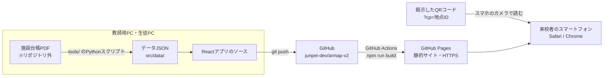
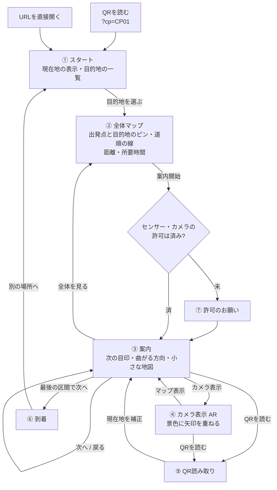

# 設計書 — 延岡工業高校 校内ARナビ（armap-v2）

| 項目 | 内容 |
|---|---|
| 版 | 0.1（初版ドラフト） |
| 作成日 | 2026-10-21 |
| 対応する要件定義書 | [01_要件定義書.md](01_要件定義書.md) v0.2 |

この設計書は「どう作るか」を決める。要件の番号（F-xx）は要件定義書を参照。

---

## 1. 設計の基本方針

| 方針 | 理由 |
|---|---|
| **データとコードを分ける** | 部屋や経路の追加をJSONの編集だけで済ませる。データ担当の生徒がReactを知らなくても作業できる |
| **距離・方向はデータに持たず、座標から計算する** | 「距離は12m」「方向は右」を手で書くと、座標と食い違ったときにどちらが正しいか分からなくなる |
| **経路計算・向きの計算はReactから切り離す** | 純粋なTypeScriptの関数にしてテストできるようにする。画面担当と計算担当が別々に作業できる |
| **地図は図面の画像を使わず、データから描く** | 図面を公開しない。拡大しても線がぼけない |
| **案内の主役はセンサー不要の表示** | 全体マップと文字の案内はどの端末でも必ず動く。AR表示は付加機能とし、壊れても案内は続けられる |
| **データの読み込みを1か所にまとめる** | 将来データベース（Cloudflare D1）に移すとき、読み込み部分だけを差し替えれば済む |

## 2. システム構成



- サーバー処理はない。アプリとデータはすべてビルド時に静的ファイルになる
- カメラ映像・センサーの値は端末の中だけで使い、どこにも送らない

## 3. 技術構成

| 区分 | 採用 | 備考 |
|---|---|---|
| 言語 | TypeScript | 型があるとデータの書き間違いに早く気づける |
| UI | React 19 | 関数コンポーネント＋フックのみ使う |
| ビルド | Vite | `base: '/armap-v2/'`（GitHub Pages のパス） |
| 地図の描画 | SVG（自作） | 地図ライブラリは使わない。座標がメートルなので `viewBox` にそのまま使える |
| 地図の拡大・移動 | react-zoom-pan-pinch | ピンチ操作の自作は難しいためライブラリに任せる |
| QR読み取り | jsQR | iPhone Safari でも動く。QRの四隅の座標が取れる（マーカーARに使う） |
| QR生成（印刷シート） | qrcode | 開発者向け画面でのみ使う |
| テスト | Vitest | 経路計算・向きの計算・データ検査 |
| 公開 | GitHub Pages ＋ GitHub Actions | push すると自動でビルドして公開 |
| 図面からの座標抽出 | Python ＋ PyMuPDF（`fitz`） | 教師用PCでのみ実行。PDFはリポジトリに入れない |

画面の切り替えは件数が少ないため、ルーターライブラリを使わず、アプリの状態（state）で切り替える（7章）。

## 4. 座標系

### 4.1 全体座標系

校地全体で共通の座標系を1つだけ使う。

| 項目 | 定義 |
|---|---|
| 基準 | 配置図（図面1ページ目）を**画面に表示したときの向き**（ページの上が上） |
| 単位 | メートル |
| x軸 | 右向きが正 |
| y軸 | **下向きが正**（SVGの座標と同じ。地図をそのまま描ける） |
| 原点 | 配置図ページの左上隅（後から平行移動しても計算には影響しない） |
| 階 | 整数（1, 2, 3, 4）。座標とは別に持つ |

### 4.2 角度の決め方

| 項目 | 定義 |
|---|---|
| 図面角度 | 図面の**上を0度、時計回りに正**（右＝90度、下＝180度、左＝270度） |
| 方位との関係 | 方位（北0度・時計回り）＝図面角度＋`mapNorthBearing`。`mapNorthBearing` は「図面の上方向が北から何度か」 |
| `mapNorthBearing` の初期値 | **未設定（null）**。要件どおり図面を正とし、磁気コンパスを補助に使うと決めた時点で現地で実測して設定する |

図面角度を方位と同じ「上0度・時計回り」にしておくと、実測値を足すだけで方位に変換できる。

2点間の図面角度は次で求める（y軸が下向きなので符号に注意）。

```ts
// a から b へ向かう図面角度（0〜360度）
function planAngle(a: Point, b: Point): number {
  const deg = (Math.atan2(b.x - a.x, -(b.y - a.y)) * 180) / Math.PI;
  return (deg + 360) % 360;
}
```

### 4.3 PDFから全体座標への変換

調べた結果、施設台帳PDFは**全ページが線（ベクター）データ**で、ページが270度回転した状態で保存されている。PyMuPDF で線を読み、次の手順で全体座標に変換する。

1. `page.get_drawings()` で線分を取り出す（PDF内部の座標・単位はpt）
2. `page.rotation_matrix` を掛けて、画面に表示したときの座標に直す
3. 縮尺1/1600なので `1pt = 25.4 / 72 × 1600 / 1000 = 0.56444 m` を掛ける

**精度の確認**: 配置図から抜き出した長方形の寸法と、平面図（1/600）に書かれた寸法を比べた。

| 棟 | 配置図から抽出 | 平面図の寸法 |
|---|---|---|
| ㉘ 機械科実習棟 | 40.0 × 10.0 m | 40.00 × 10.00 m |
| ㊸ 普通教室棟 | 44.0 × 9.3 m | 44.00 × 9.30 m |
| 64 機械科実習棟 | 39.3 × 13.0 m | 39.30 × 13.00 m |
| 66 生活文化科棟 | 31.9 × 13.0 m | 31.90 × 13.00 m |

→ 配置図の線データは**0.1m単位で平面図と一致**する。手で測る必要はなく、棟の位置と外形は抽出スクリプトで取り出せる。

### 4.4 棟の中の座標（平面図）

各棟の平面図（1/600）には部屋の寸法が書かれている。部屋や廊下の位置は、まず**棟ごとの座標（ローカル座標）**で書き、全体座標に変換する。

| 項目 | 定義 |
|---|---|
| ローカル座標 (u, v) | 平面図を**図面のページどおりの向き**で見たとき、棟の外形の左上隅を原点、右が u、下が v（メートル） |
| 変換 | `全体座標 = 棟の基準点 + 回転(rotation) × (u, v)` |
| rotation | 0 / 90 / 180 / 270 のいずれか。配置図の棟はすべて縦横に沿って描かれているため、90度単位で足りる |

棟の基準点と rotation は、配置図の外形と平面図の外形を重ねて決める（手順書で作業を定める）。平面図と配置図で棟の向きが逆になっていることがあるため、階段や渡り廊下の位置を手がかりに、どちらが同じ端かを確かめる。

## 5. データ設計

### 5.1 ファイル構成

```
src/data/
├── config.json        アプリ全体の設定（mapNorthBearing・歩く速さなど）
├── buildings.json     棟（外形・階数・座標変換）
├── nodes.json         ノード（経路上の地点）
├── edges.json         辺（ノード同士のつながり）
├── rooms.json         部屋（目的地）
└── checkpoints.json   QRチェックポイント
```

量が増えて1ファイルが長くなったら、`nodes/28.json` のように棟ごとに分ける（読み込み部分で結合する）。

### 5.2 型定義（`src/types.ts`）

```ts
/** 全体座標の点（メートル） */
export type Point = { x: number; y: number };

/** 棟 */
export type Building = {
  id: string;            // 施設台帳の棟番号。例: "1", "28", "57"
  name: string;          // 来校者向けの名前。例: "管理・教室棟"
  drawingName: string;   // 図面上の名前。例: "管理，教室棟"
  floors: number;        // 階数
  outline: Point[];      // 外形（全体座標・時計回り）。全体マップの描画に使う
  label?: Point;         // 棟名を表示する位置（省略時は外形の中心）
  origin?: Point;        // ローカル座標の原点（全体座標）。平面図を入力した棟のみ
  rotation?: 0 | 90 | 180 | 270;
};

/** ノードの種類 */
export type NodeKind =
  | "corridor"   // 廊下の曲がり角・分岐
  | "door"       // 部屋の入口
  | "entrance"   // 棟の出入口
  | "stairs"     // 階段（各階に1つずつノードを置く）
  | "outdoor";   // 屋外の分岐・目印

/** ノード */
export type GraphNode = {
  id: string;           // 例: "B1-1F-C02"
  building?: string;    // 屋外なら省略
  floor: number;        // 屋外は 1
  kind: NodeKind;
  local?: { u: number; v: number }; // 棟のローカル座標（4.4）。平面図の寸法から書く
  pos?: Point;          // 全体座標。屋外ノードはこちらで書く
  landmark?: string;    // 目印の説明。例: "正面の階段" "自動販売機のある出入口"
};
// local と pos はどちらか一方を書く。local を書いた場合、読み込み時（loader.ts）に
// 棟の origin と rotation から pos を計算する。手で変換しなくてよい。

/** 辺 */
export type Edge = {
  from: string;
  to: string;
  kind?: "walk" | "stairs" | "bridge"; // 省略時は walk。bridge は2階の渡り廊下
  oneway?: boolean;     // 一方通行（基本は使わない）
  closed?: boolean;     // 一時的に通れない（工事など）
};

/** 部屋（目的地） */
export type Room = {
  id: string;           // 例: "R-28-1F-staff"
  name: string;         // 来校者向けの名前。例: "機械科 職員室"
  drawingName: string;  // 図面上の名前。例: "準備室"
  aliases?: string[];   // 検索用の別名。例: ["機械科", "機械"]
  building: string;
  floor: number;
  node: string;         // 入口のノードID（案内の終点）
  category: "admin" | "department" | "general" | "special";
  description?: string; // 到着時に出す一言
};

/** QRチェックポイント */
export type Checkpoint = {
  id: string;           // URLに入る地点ID。例: "CP01"
  node: string;         // 対応するノードID
  facing: number;       // 掲示面の向き（図面角度）。壁から外に向かう方向
  place: string;        // 掲示場所の説明。例: "事務室窓口の右側の壁"
};
```

### 5.3 データの例（管理・教室棟① 1階・一部）

平面図の寸法（7.10＋2.50の幅、北から 進路指導室9.60／印刷室4.50／保健室9.00／便所4.50／階段4.00、続いて 事務室9.00／校長室9.00／職員室18.00）から、廊下の中心線は u = 7.10 + 2.50 / 2 = **8.35m**。扉の位置は図面にないため、当面は部屋の中央とし、現地確認で直す。

```jsonc
// nodes.json（屋内はローカル座標 local で書く。v は平面図の上端からの距離）
[
  // 階段 27.60〜31.60 の中央
  { "id": "B1-1F-S1",         "building": "1", "floor": 1, "kind": "stairs",
    "local": { "u": 8.35, "v": 29.6 }, "landmark": "ホール横の階段" },
  // 事務室 31.60〜40.60 の中央
  { "id": "B1-1F-D-jimu",     "building": "1", "floor": 1, "kind": "door",
    "local": { "u": 8.35, "v": 36.1 }, "landmark": "事務室の窓口" },
  // 校長室 40.60〜49.60 の中央
  { "id": "B1-1F-D-kocho",    "building": "1", "floor": 1, "kind": "door",
    "local": { "u": 8.35, "v": 45.1 }, "landmark": "校長室の入口" },
  // 職員室 49.60〜67.60 の中央
  { "id": "B1-1F-D-shokuin",  "building": "1", "floor": 1, "kind": "door",
    "local": { "u": 8.35, "v": 58.6 }, "landmark": "職員室の入口" }
]
```

※ 平面図の部屋の寸法の合計（31.60＋36.00＝67.60m）と、全長の寸法（67.49m）が0.11m合わない。案内には影響しない差なので、部屋の寸法の積み上げを使う。

```jsonc
// rooms.json
[
  { "id": "R-1-1F-shokuin", "name": "職員室", "drawingName": "職員室",
    "building": "1", "floor": 1, "node": "B1-1F-D-shokuin", "category": "admin" },
  { "id": "R-28-1F-staff", "name": "機械科 職員室", "drawingName": "準備室",
    "aliases": ["機械科", "機械"], "building": "28", "floor": 1,
    "node": "B28-1F-D-staff", "category": "department" }
]
```

```jsonc
// checkpoints.json
[
  { "id": "CP01", "node": "B1-1F-D-jimu", "facing": 90,
    "place": "事務室窓口の横の壁（廊下側）" }
]
```

### 5.4 IDの付け方

| 対象 | 形式 | 例 |
|---|---|---|
| ノード（屋内） | `B{棟}-{階}F-{種類}{番号または名前}` | `B1-1F-C03`、`B28-1F-D-staff`、`B1-2F-S1` |
| ノード（屋外） | `OUT-{番号}` | `OUT-12` |
| 部屋 | `R-{棟}-{階}F-{名前}` | `R-1-2F-kaigi` |
| チェックポイント | `CP{2桁}` | `CP01`（事務室） |

種類の記号: C＝廊下、D＝扉、E＝出入口、S＝階段

### 5.5 データの自動検査（F-51）

`npm run check-data` で次を検査する。GitHub Actions でもビルドの前に実行し、誤りがあれば公開しない。

| 検査 | 内容 |
|---|---|
| ID の重複 | ノード・部屋・チェックポイント |
| 座標 | ノードに `local` か `pos` のどちらか一方があるか。`local` を使う棟に `origin` と `rotation` があるか |
| 参照切れ | 辺・部屋・チェックポイントが存在しないノードを指していないか |
| つながり | **事務室のノードから、すべての部屋に経路があるか** |
| 階段 | 階段の辺の両端が、同じ棟で階が1つ違うか |
| 屋外/屋内 | 屋内ノードが棟の外形の内側にあるか |
| 角度 | `facing` が 0〜360 か |

## 6. 経路案内の計算

すべて `src/core/` の純粋な関数として作り、Vitest でテストする。

### 6.1 経路探索

- 辺の重み＝2点間の距離（座標から計算）。階段は「上下1階あたり10m」を加算し、なるべく階段を使わない経路を選ばせる
- `closed: true` の辺は除外する
- アルゴリズムは**ダイクストラ法**（ノードが数百個なので十分速い。高校の授業で扱える）

### 6.2 区間（ステップ）への分割

経路のノード列をそのまま案内すると「次へ」の回数が多すぎる。次の規則でまとめて**区間**にする。

区間の切れ目にするノード:

1. 曲がる角度が **30度以上** のノード
2. 棟の出入口（`entrance`）
3. 階段（階が変わる）
4. QRチェックポイントのノード
5. 目的地

切れ目でないノード（ほぼまっすぐ進む途中の点）は、前の区間に含める。

### 6.3 曲がる方向の判定（F-23）

区間の切れ目で、入ってくる向きと出ていく向きの差 Δ（−180〜180度）から決める。センサーは使わない。

| Δ | 表示 |
|---|---|
| −30〜30度 | まっすぐ |
| 30〜150度 | 右へ |
| −150〜−30度 | 左へ |
| 150度以上 | 引き返す |
| 階が変わる | 階段で○階へ（上る/下りる） |

### 6.4 案内文の組み立て

```
{目印}まで 約{距離}m 進み、{曲がる方向}
例: 「ホール横の階段まで 約18m 進み、階段で2階へ」
```

- 目印はノードの `landmark`。未入力なら「突き当たり」「次の角」などの既定の言葉を使う
- 距離は5m単位で丸める（細かい数字は来校者にとって意味がない）
- 所要時間は、歩く速さ 1.0 m/s ＋ 階段1階あたり15秒で見積もる（`config.json` で変更可）

### 6.5 現在地の扱い

```ts
type NavState = {
  route: Step[];          // 区間の列
  stepIndex: number;      // 今いる区間
  anchor?: {              // 最後にQRで確定した情報
    checkpointId: string;
    headingOffset: number; // 6.6 で使う
    at: number;            // 時刻（ms）
    stepsSince: number;    // その後に「次へ」を押した回数
  };
};
```

- 「次へ」で `stepIndex + 1`、「戻る」で `−1`
- QRを読んだとき（F-30〜F-32）:
  - 経路上のチェックポイント → `stepIndex` をその区間に合わせる
  - 経路外 → そのノードから経路を引き直す

### 6.6 向きの推定（AR表示用）

利用者が今どちらを向いているかを、図面角度で求める。

```
利用者の向き（図面角度） = 端末の回転角 + headingOffset
```

| 場面 | 処理 |
|---|---|
| QRを読んだ瞬間 | 利用者はQRの正面に立ち、カメラを壁に向けている。つまり利用者の向き＝`facing + 180`。このときの端末の回転角との差を `headingOffset` として保存する |
| その後 | ジャイロによる端末の回転角に `headingOffset` を足すだけ。磁気は使わない |
| QRを一度も読んでいない | 出発点のQRから開いた場合は、その時点で確定済み。URL直接の場合は「向き不明」 |
| 補助（`mapNorthBearing` 設定後） | 屋外で、向き不明または信頼度が低いときに限り、コンパスの方位から `headingOffset` を作る |

端末の回転角:

- **iPhone**: `deviceorientation` の `alpha`（起動時を基準とした相対角）。`webkitCompassHeading` は磁気なので補助のときだけ使う
- **Android**: `deviceorientation`（相対）。補助のときは `deviceorientationabsolute`
- スマホを**縦に立ててカメラを前に向けた持ち方**でも正しく出るよう、`alpha / beta / gamma` から**カメラの向いている方向を水平面に投影した角度**を計算する（`src/core/heading.ts`）

**信頼度**（F-42）:

| 状態 | 信頼度 | 矢印の表示 |
|---|---|---|
| QRを読んでから2分以内かつ「次へ」3回以内 | 高 | 通常 |
| それ以外でオフセットあり | 低 | 半透明＋「QRを読むと正確になります」 |
| 向き不明・センサー許可なし | なし | 矢印を出さず、文字の案内のみ |

## 7. 画面設計

### 7.1 画面の流れ



開発者向け画面（URLに `?dev=map` などを付けたときだけ表示）:

- **データ確認画面**（F-52）: 全体マップに全ノード・辺・チェックポイントを重ねて表示。ノードをタップするとIDと座標が出る
- **QR印刷シート**（F-53）: チェックポイントごとにQR・地点名・掲示場所・掲示面の向きを並べて印刷する

### 7.2 各画面

**① スタート**

```
┌──────────────────────┐
│ [校章] 延岡工業高校 校内案内 │
│ 現在地: 事務室前   [変更]  │
├──────────────────────┤
│ どこへ行きますか？          │
│ ▼ 管理棟                   │
│   職員室 / 校長室 / 保健室 … │
│ ▼ 各科の職員室              │
│   機械科 / 電気電子科 / …    │
└──────────────────────┘
```

**② 全体マップ**（F-15〜F-19）

```
┌──────────────────────┐
│  ┌─┐  ┌──┐              │
│  │ │  │  │   ● 目的地     │
│  └─┘  └──┘ ╱            │
│     ┌────╱┐  ← 道順の線  │
│     │ ◎ 現在地│           │
│     └──────┘            │
├──────────────────────┤
│ 機械科 職員室（28棟 1階）     │
│ 約180m・徒歩 約4分           │
│ 管理棟を出て、実習棟の方へ    │
│        [ 案内を開始する ]     │
└──────────────────────┘
```

- 地図の向きは配置図と同じ（校内の人が見慣れた向き）に固定する
- 棟は灰色の面、目的地の棟は色をつける。2階を通る区間は点線にし「2F」と添える
- 出発点（◎）と目的地（●）のピンは、拡大・縮小しても同じ大きさで表示する

**③ 案内**（F-21〜F-28）

```
┌──────────────────────┐
│ 2 / 5                      │
│      ↱  右へ               │
│ 「ホール横の階段まで約18m」  │
│ ┌────────────────┐ │
│ │ 小さな地図（今の区間を強調）│ │
│ └────────────────┘ │
│ □ この先にQRがあります       │
│ [戻る] [カメラ] [QR] [ 次へ ] │
└──────────────────────┘
```

- 「次へ」は親指で押しやすい右下に大きく置く

**④ カメラ表示**（F-40〜F-43）

- 背面カメラの映像を全画面に表示し、その上に矢印を重ねる（8章）
- 画面下に③と同じ案内文と「次へ」ボタンを出す
- 「立ち止まって確認してください」を常に表示する

### 7.3 状態の持ち方

```ts
type Screen = "start" | "overview" | "guide" | "camera" | "scan" | "arrived";

type AppState = {
  screen: Screen;
  origin: string;          // 出発点のノードID（QRの地点 or 事務室）
  destination?: string;    // 部屋ID
  nav?: NavState;          // 6.5
  sensorPermission: "unknown" | "granted" | "denied";
};
```

- 状態は `useReducer` で1か所にまとめる（生徒が「どこで状態が変わるか」を追いやすくするため）
- 再読み込みで消えないよう、`sessionStorage` に保存する

## 8. カメラ表示（AR）の描画

### 8.1 矢印の重ね表示（F-41）

1. `getUserMedia({ video: { facingMode: "environment" } })` で背面カメラを `<video>` に表示
2. 次に向かう方向 `target`（図面角度・6章）と、利用者の向き `heading`（6.6）の差 `rel = target − heading` を求める
3. 矢印（SVG）を `rel` だけ回転させ、CSS の `perspective` と `rotateX` で**地面に寝かせたように**見せる
4. 端末の回転に合わせて毎フレーム（`requestAnimationFrame`）更新する。値のぶれは移動平均でならす

床に正確に貼り付けるわけではない（平面検出をしない）。「前方の地面に矢印がある」ように見える表現にとどめる。

### 8.2 QRを基準にした矢印（マーカーAR・F-43）

QRの位置と向きが分かっている瞬間だけ、矢印を実際の壁に合わせて表示する。

1. jsQR でQRを読むと、映像上の**QRの四隅の座標**が得られる
2. 正方形（QR）→ 映像上の四角形 への**射影変換（ホモグラフィ）**を計算する（4点から8つの係数を解く）
3. その変換を CSS の `matrix3d` にして、矢印の要素に適用する → 矢印がQRの貼られた壁の上に描かれる
4. 矢印の向きは、次に進む方向と壁の向きの関係から決める（壁に沿って右・左、または背後）

three.js などの3Dライブラリは使わない（CSSだけで実現でき、生徒が中身を理解しやすい）。

### 8.3 カメラが使えないとき（F-28 相当）

- 許可されない・カメラがない → カメラボタンを無効にし、③の画面だけで案内する
- HTTPS でないとカメラが使えないため、ローカルで実機テストするときの方法を手順書に書く

## 9. ディレクトリ構成

```
armap-v2/
├── docs/                    設計資料
├── tools/                   図面からデータを作るスクリプト（Python）
│   ├── extract_outlines.py  配置図から棟の外形を抽出 → buildings の下書き
│   └── render_pages.py      図面を画像に書き出す（作業用・drawings/ に出力。gitに入れない）
├── public/
│   └── icon.png             校章（アイコン）
├── src/
│   ├── types.ts             型定義（5.2）
│   ├── data/                データJSON（5.1）
│   │   └── loader.ts        データの読み込み（将来DBに差し替える場所）
│   ├── core/                Reactに依存しない計算（テスト対象）
│   │   ├── geometry.ts      距離・角度・座標変換
│   │   ├── route.ts         経路探索・区間分割・曲がる方向（6.1〜6.4）
│   │   ├── heading.ts       端末の向き・オフセット・信頼度（6.6）
│   │   ├── homography.ts    射影変換（8.2）
│   │   └── validate.ts      データ検査（5.5）
│   ├── hooks/               センサー・カメラ・QR読み取りのフック
│   ├── screens/             画面（Start / Overview / Guide / Camera / Scan / Arrived）
│   ├── components/          部品（CampusMap・StepCard・Arrow など）
│   ├── dev/                 開発者向け画面（データ確認・QR印刷）
│   ├── App.tsx
│   └── main.tsx
├── tests/                   Vitest のテスト
├── .github/workflows/deploy.yml
├── vite.config.ts
└── package.json
```

### 9.1 生徒の分担の目安

| 担当 | 主な場所 | 必要な知識 |
|---|---|---|
| データ | `src/data/`・`tools/`・現地調査 | JSON・図面の読み方（Reactは不要） |
| 経路計算 | `src/core/route.ts`・`geometry.ts` | TypeScript・ダイクストラ法・三角関数 |
| 画面 | `src/screens/`・`components/` | React |
| センサー・AR | `src/hooks/`・`core/heading.ts`・`homography.ts` | ブラウザAPI・三角関数・行列 |

## 10. ビルドと公開

| 項目 | 内容 |
|---|---|
| 公開URL | `https://junpei-dev.github.io/armap-v2/` |
| QRのURL | `https://junpei-dev.github.io/armap-v2/?cp=CP01`（CP01＝事務室） |
| 公開の流れ | `main` に push → GitHub Actions で `npm ci` → `npm run check-data` → `npm test` → `npm run build` → Pages へ公開 |
| 失敗したとき | データ検査かテストが失敗すると公開されない（前の版がそのまま残る） |

QRに印刷するURLは、公開先を Cloudflare に移すと変わってしまう。そのため**QRの印刷はスケジュールの最後に回し、教員から依頼があった時点で作成する**（2026-10-21 決定）。それまでの実機テストは、画面上のQRや仮印刷で行う。

## 11. テスト

| 種類 | 内容 | 方法 |
|---|---|---|
| 単体テスト | 図面角度・座標変換・経路探索・区間分割・曲がる方向・ホモグラフィ | Vitest |
| データ検査 | 5.5 の項目 | `npm run check-data` |
| 画面の確認 | 各画面の表示・遷移 | PCのブラウザ（スマホ表示モード） |
| 実機テスト | iPhone・Android で、QR読み取り・センサー許可・矢印の回転 | 公開URLで現地を歩く |
| 通しテスト | 来校者役（その棟を知らない生徒）が、説明なしで目的地に着けるか | 現地 |

実機テストの記録項目: 端末・ブラウザ／目的地／到着できたか／迷った地点／矢印のずれ（目視）／かかった時間

## 12. 将来の拡張への備え

| 拡張 | 備え |
|---|---|
| データベース（Cloudflare D1） | `src/data/loader.ts` だけを API 呼び出しに差し替える。型（5.2）はそのまま |
| 全約150室への拡大 | 平面図を入力した棟から順に `rooms.json` に追加するだけ。コードの変更は不要 |
| 帰り道・最寄りの便所（F-60・F-61） | 経路探索の出発点と終点を入れ替える／カテゴリで最も近い部屋を探す |
| 方位の実測 | `config.json` の `mapNorthBearing` に1つの値を入れるだけ |

## 13. 未決事項

| No. | 内容 | 決める時期 |
|---|---|---|
| D-1 | 各棟の平面図と配置図の向きの対応（rotation） | データ作成時（棟ごと） |
| D-2 | 扉の位置（当面は部屋の中央） | 現地調査 |
| D-3 | 屋外の通路と、各棟の出入口の位置 | 現地調査（最優先） |
| D-4 | QRチェックポイントの場所と枚数 | 現地調査の後 |
| D-5 | 地図の配色・アプリの見た目（校章の使用を含む） | 画面の実装時 |
