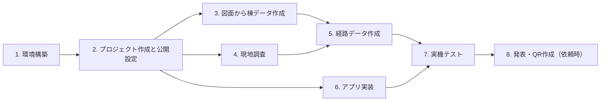

# 手順書 — 延岡工業高校 校内ARナビ（armap-v2）

| 項目 | 内容 |
|---|---|
| 版 | 0.1（初版ドラフト） |
| 作成日 | 2026-10-21 |
| 対応する文書 | [01_要件定義書.md](01_要件定義書.md) v0.2 / [02_設計書.md](02_設計書.md) v0.1 |
| 期間 | 2026-10-21（水）〜 2026-12 下旬 |

この手順書は「誰が・いつ・何を・どうやって」行うかを定める。コマンドは **VS Code のターミナル（PowerShell）** で実行する前提で書く。

---

## 0. 全体の流れ



- 3（図面）・4（現地調査）・6（実装）は**並行して進める**。担当を分ければ互いに待たずに済む
- 一番遅れやすいのは **4. 現地調査**。第1〜2週で必ず終わらせる

## 1. 環境構築

### 1.1 教師用PC（メインの開発機）

確認済み: Node.js v24.18 / npm 11.16 / git 2.54 / Python（PyMuPDF 利用可）

1. リポジトリを取得する（初回のみ。すでに `C:\programming\ARMAP` がある教師用PCでは不要）

```bash
git clone https://github.com/junpei-dev/armap-v2.git
```

2. VS Code でフォルダを開き、ターミナル（メニューの「ターミナル」→「新しいターミナル」）を開く
3. 図面PDF（`29_R7延岡工業_図面.pdf`）をフォルダの直下に置く。**PDFはgitに入らない**（`.gitignore` で除外済み）

### 1.2 生徒用PC

学校管理のPCには Node.js が入っていないことがある。まず確かめる。

```bash
node -v
```

- バージョンが表示されれば、1.1 と同じ手順で進める
- 「認識されません」と出たら、次のどちらかにする
  - **A. 教師用PCで作業する**（簡単。データ担当・現地調査担当はこれで十分）
  - **B. ポータブル版 Node.js を使う**（Node.js 公式サイトの zip 版を `C:\Users\<ユーザー名>\tools\nodejs` に展開し、ターミナルを開くたびに次を実行する）

```bash
$env:Path = "$env:USERPROFILE\tools\nodejs;$env:Path"
```

学校PCで git が `unable to read config file` と出る場合は 10章を参照。

### 1.3 VS Code の拡張機能（推奨）

- ESLint
- Prettier
- Japanese Language Pack

## 2. プロジェクト作成と公開設定（第1週・教員＋画面担当）

### 2.1 Vite で React プロジェクトを作る

既存の `docs/` などを残したまま、フォルダの中に作る。

```bash
npm create vite@latest . -- --template react-ts
```

- 「Current directory is not empty」と聞かれたら **Ignore files and continue** を選ぶ
- 終わったら依存パッケージを入れる

```bash
npm install
```

設計書3章のライブラリを追加する。

```bash
npm install jsqr react-zoom-pan-pinch qrcode
```

```bash
npm install -D vitest @types/qrcode
```

### 2.2 手元で動かす

```bash
npm run dev
```

- 表示された `http://localhost:5173/armap-v2/` をブラウザで開く
- スマホの画面を確かめるときは、ブラウザで F12 → 端末のアイコン（デバイスツールバー）で iPhone などを選ぶ
- 止めるときはターミナルで `Ctrl + C`

※ カメラとセンサーは、スマホ実機＋HTTPSでないと動かない。実機での確認は 7章の方法で行う。

### 2.3 Vite の設定

`vite.config.ts` に公開先のパスを書く（GitHub Pages は `/リポジトリ名/` の下に公開されるため）。

```ts
export default defineConfig({
  base: "/armap-v2/",
  plugins: [react()],
});
```

### 2.4 GitHub Pages の公開設定（教員・初回のみ）

1. GitHub の armap-v2 のページ → **Settings** → **Pages**
2. **Source** を **GitHub Actions** にする
3. `.github/workflows/deploy.yml` を作る（中身はプロジェクト作成時に Claude に依頼する。設計書10章の流れ: `npm ci` → データ検査 → テスト → ビルド → 公開）
4. push すると **Actions** タブで進み具合が見られる。緑のチェックが付けば公開完了
5. 公開URL: `https://junpei-dev.github.io/armap-v2/`

### 2.5 git の使い方（全員）

生徒は `main` に直接 push せず、**作業ごとにブランチを作り、プルリクエスト（PR）で教員が確認してから取り込む**。

| 操作 | コマンド |
|---|---|
| 最新を取ってくる | `git pull` |
| 作業用ブランチを作る | `git switch -c data/building-28` |
| 変更を確認 | `git status` |
| 記録する | `git add .` → `git commit -m "28棟の1階ノードを追加"` |
| GitHubに送る | `git push -u origin data/building-28` |
| PRを作る | GitHub のページに出る「Compare & pull request」を押す |

ブランチ名の例: `data/〜`（データ）、`feat/〜`（機能）、`fix/〜`（修正）、`docs/〜`（文書）

## 3. 図面から棟データを作る（第1〜2週・データ担当）

設計書4.3章のとおり、配置図は線データなので、棟の外形はスクリプトで取り出せる。

※ `tools/` のスクリプト（`render_pages.py`・`extract_outlines.py`）は**第1週に作成する（2026-10-21 時点では未作成）**。抽出の方法は試作で確認済み。

### 3.1 図面を画像に書き出す（作業用）

```bash
python tools/render_pages.py
```

- `drawings/` に各ページの画像ができる（gitには入らない）
- 平面図を読むときはこの画像を拡大して使う

### 3.2 棟の外形を抽出する

```bash
python tools/extract_outlines.py
```

出力:

| ファイル | 内容 |
|---|---|
| `drawings/outlines_preview.png` | 配置図の上に、抽出した長方形を番号つきで描いた画像 |
| `tools/outlines_draft.json` | 長方形ごとの全体座標（メートル）と寸法 |

### 3.3 番号と棟を対応づける

1. `outlines_preview.png` と配置図を見比べ、長方形の番号がどの棟か調べる
2. `tools/building_map.json` に書く

```jsonc
{
  "12": { "id": "28", "name": "機械科実習棟", "floors": 2 },
  "15": { "id": "64", "name": "機械科実習棟", "floors": 2 }
  // 図枠・道路・自転車置き場など、棟でないものは書かない
}
```

3. 寸法が平面図と合っているか確かめる（例: ㉘は 40.00×10.00m）
4. 次を実行すると `src/data/buildings.json` ができる

```bash
python tools/extract_outlines.py --apply
```

- 長方形でない棟（①管理・教室棟のL字部分など）は、`buildings.json` の `outline` を手で直す
- **確認方法**: アプリのデータ確認画面（`?dev=map`）で、全体マップが配置図と同じ形に見えればよい

### 3.4 棟の向き（rotation）と基準点（origin）を決める

平面図の座標（u, v）を全体座標に変換するために、棟ごとに決める（設計書4.4章）。MVPで使う7棟（①・㉘・57・64・㊽・㉒・66）を先に行う。

1. 平面図の左上隅が、配置図ではどの隅にあたるかを調べる
   - 手がかり: 階段の位置、渡り廊下のつながる位置、L字の形
   - 平面図と配置図で上下が逆のことがある
2. その隅の全体座標を `origin`、平面図から配置図への回転を `rotation`（0 / 90 / 180 / 270）として `buildings.json` に書く
3. データ確認画面で、階段や扉のノードが棟の正しい側に表示されるか確かめる

## 4. 現地調査（第1〜2週・現地調査担当＋教員）

**最優先の作業**。図面には出入口と屋外の通路が描かれていないため、ここが終わらないと各科職員室への経路が作れない。

### 4.1 準備するもの

- 調査シート（付録A）を印刷したもの。対象の棟の平面図（`drawings/` の画像）も一緒に印刷する
- 筆記用具・バインダー
- メジャー（あれば。なくても歩数でよい。1歩 ≒ 0.7m）
- スマートフォン（写真を撮る）

### 4.2 調べること

| No. | 内容 | 記録の仕方 |
|---|---|---|
| 1 | 各棟の**出入口**の位置と、ふだん開いているか | 平面図に ○ を描く。「棟の北端から約○m」 |
| 2 | 管理棟から各棟までの**屋外の歩けるルート**（屋根のある通路を優先） | 配置図に線を描く。曲がり角に番号 |
| 3 | 曲がり角・分かれ道の**目印**（自販機・掲示板・植え込みなど） | 番号ごとに一言＋写真 |
| 4 | **階段**の位置（平面図の階段記号と合っているか） | 平面図に印 |
| 5 | 目的の部屋の**扉**の位置（部屋のどちら寄りか） | 平面図に印 |
| 6 | 通れない場所（施錠・立入禁止・工事中） | 配置図に × |
| 7 | 部屋の表示板の名前（図面の名前と違うか） | 一覧に記録 |
| 8 | QRを貼れそうな壁（出入口・階段・渡り廊下の端） | 平面図に □（掲示は後日） |

### 4.3 調査の順番

| 日 | 範囲 |
|---|---|
| 1日目 | 管理・教室棟①の1・2階（事務室・職員室・校長室・保健室・進路指導室・会議室） |
| 2日目 | 管理棟 → ㉘機械科・57電気電子科・64情報技術科 |
| 3日目 | 管理棟 → ㊽土木科・㉒環境化学システム科・66生活文化科 |
| 予備日 | 抜けの確認・写真の撮り直し |

### 4.4 調査後

- 調査シートと写真を共有フォルダに置く（写真はgitに入れない。人が写っているものは使わない）
- データ担当と一緒に、配置図上の線をノードと辺に置き換える（5章）

## 5. 経路データを作る（第2〜7週・データ担当）

設計書5章の形式で `src/data/` のJSONを書く。

### 5.1 1棟ずつの作業手順

1. **ノードを置く**（`nodes.json`）
   - 屋内: 平面図の寸法から `local`（u, v）を計算して書く。廊下の中心線、扉の前、階段、出入口に置く
   - 屋外: 調査で描いた線の曲がり角に `pos`（全体座標）で置く。座標はデータ確認画面でタップして読む
   - 目印になる説明を `landmark` に書く（例: 「自動販売機のある出入口」）
2. **辺でつなぐ**（`edges.json`）。階段は上下の階のノード同士を `"kind": "stairs"` でつなぐ
3. **部屋を登録する**（`rooms.json`）。来校者向けの名前（`name`）と図面上の名前（`drawingName`）を両方書く
4. **検査する**

```bash
npm run check-data
```

5. データ確認画面で形を確かめ、ブランチを push して PR を出す

### 5.2 進める順番

| 順 | 範囲 | 目的地 |
|---|---|---|
| 1 | ① 1階 | 職員室・校長室・保健室・進路指導室（事務室から同じ階） |
| 2 | ① 2階＋階段 | 会議室（階の移動の確認） |
| 3 | 屋外＋㉘ | 機械科 職員室（屋外経路の確認） |
| 4 | 57・64 | 電気電子科・情報技術科 職員室 |
| 5 | ㊽・㉒・66 | 土木科・環境化学システム科・生活文化科 職員室 |

### 5.3 ローカル座標の計算例（① 1階）

平面図: 幅 9.60m ＝ 部屋 7.10m ＋ 廊下 2.50m。北（図面の上）から 進路指導室 9.60／印刷室 4.50／保健室 9.00／便所 4.50／階段 4.00／事務室 9.00／校長室 9.00／職員室 18.00。

- 廊下の中心: u = 7.10 + 2.50 ÷ 2 = **8.35**
- 事務室の中央: v = 9.60 + 4.50 + 9.00 + 4.50 + 4.00 + 9.00 ÷ 2 = **36.1**

この「寸法を上から足していく」計算を、表計算ソフトで行うと間違いが減る。

## 6. アプリ実装（第2〜7週・経路計算／画面／センサー担当）

設計書9.1章の分担で進める。各担当の作業は、**テスト（Vitest）か画面で確かめられる単位**に区切る。

### 6.1 担当別のタスク

| 週 | 経路計算 | 画面 | センサー・AR |
|---|---|---|---|
| 2 | `geometry.ts`（距離・図面角度・座標変換）＋テスト | 画面の骨組み（①〜⑥を仮の表示で遷移） | センサー許可と `deviceorientation` の値を表示する試作 |
| 3 | `route.ts` 経路探索（ダイクストラ法）＋テスト | ② 全体マップ（棟の描画・ピン・拡大縮小） | `heading.ts`（カメラの向きの角度）＋テスト |
| 4 | 区間分割・曲がる方向・案内文＋テスト | ① スタート（目的地一覧）・② の道順の線 | カメラ映像の表示・jsQR でQR読み取り |
| 5 | `validate.ts`（データ検査）＋ `check-data` | ③ 案内（次へ・戻る・小さな地図） | ④ カメラ表示に矢印を重ねる・信頼度の表示 |
| 6 | QR読み取り時の経路の引き直し | ⑥ 到着・⑦ 許可のお願い・見た目の調整 | QR読み取りで向きを確定（`headingOffset`） |
| 7 | 不具合修正 | 不具合修正・開発者向けデータ確認画面 | （余裕があれば）マーカーAR（`homography.ts`） |

### 6.2 テストの実行

```bash
npm test
```

- 経路計算は、**① 1階の実データ**（事務室→職員室など）でテストを書く。答え（通るノードの順番）は図面を見て人が決める

### 6.3 実装の進め方の約束

- 1つのPRは1つの機能にする（大きすぎると確認できない）
- `src/core/` の関数には必ずテストを付ける
- 画面からは `src/core/` の関数を呼ぶだけにし、計算を画面のコードに書かない

## 7. 実機テスト（第5週〜・全員）

### 7.1 スマホで動かす方法

カメラとセンサーはHTTPSでないと動かない。また、校内Wi-FiではPCとスマホの間で通信できないことがある。そのため、**実機テストは公開URLで行う**。

1. 変更を `main` に取り込む（PRをマージ）
2. GitHub の **Actions** タブで公開の完了（緑のチェック）を待つ（2〜3分）
3. スマホで `https://junpei-dev.github.io/armap-v2/?cp=CP01` を開く
4. 古い画面が出るときは、ページを再読み込みする

画面の見た目だけなら、PCブラウザのデバイスツールバー（2.2）で確認できる。

### 7.2 テストの段階

| 段階 | 時期 | 内容 |
|---|---|---|
| ① 机上 | 第5週 | PCで全目的地の経路が出るか・全体マップの表示 |
| ② 管理棟 | 第6週 | 実機で、事務室から管理棟の5室まで歩く。QRは画面に表示したものを仮に使う |
| ③ 屋外 | 第7週 | 各科職員室まで歩く。iPhone・Android の両方で |
| ④ 通し | 第8週 | **その棟を知らない生徒**が来校者役になり、説明なしで目的地に着けるか |

### 7.3 記録表

| 日時 | 端末・ブラウザ | 出発→目的地 | 着けたか | 迷った地点 | 矢印のずれ（目視） | かかった時間 | 気づいたこと |
|---|---|---|---|---|---|---|---|
| | | | | | | | |

## 8. スケジュール

| 週 | 期間 | データ・現地調査 | 実装 | 完了の目安 |
|---|---|---|---|---|
| 1 | 10/21〜10/27 | 現地調査（管理棟）・図面の書き出し・棟の外形抽出 | プロジェクト作成・GitHub Pages 公開設定 | 空のアプリが公開URLで開く |
| 2 | 10/28〜11/3 | 現地調査（屋外・各科）・棟の対応づけ | 2週目のタスク（6.1） | 全体マップ用の `buildings.json` ができる |
| 3 | 11/4〜11/10 | ① 1階のノード・辺・部屋 | 3週目のタスク | 全体マップに棟が描ける |
| 4 | 11/11〜11/17 | ① 2階・階段 | 4週目のタスク | 事務室→職員室の経路が全体マップに線で出る |
| 5 | 11/18〜11/24 | 屋外＋㉘ | 5週目のタスク・机上テスト | 管理棟5室を案内画面で最後まで進める |
| 6 | 11/25〜12/1 | 57・64 | 6週目のタスク・管理棟の実機テスト | **管理棟5室で実機で案内できる（MVPの最低ライン）** |
| 7 | 12/2〜12/8 | ㊽・㉒・66 | 不具合修正・屋外の実機テスト | 各科職員室6室の経路ができる |
| 8 | 12/9〜12/15 | 抜けの修正 | 通しテスト・発表資料 | 11室すべてで通しテストが終わる |
| 予備 | 12/16〜12月下旬 | — | 修正・発表準備 | — |

**遅れたときの判断**: 第6週の時点で管理棟5室が実機で動いていなければ、各科職員室は「㉘機械科のみ」に絞り、残りはMVP後に回す。

## 9. QRコードの作成と掲示（依頼があったとき）

公開先が変わる可能性があるため、**QRの作成・印刷は教員から依頼があった時点で行う**（設計書10章）。それまでは次で代用する。

- 実機テストでは、データ確認画面に表示したQRを別の端末で映して読む
- 依頼があったら、QR印刷シート（設計書7.1）から印刷し、ラミネートして掲示する
- 掲示前に管理職の了承を得る（要件定義書12章 Q-2）

## 10. トラブルシューティング

| 症状 | 原因と対処 |
|---|---|
| `npm install` が止まる・失敗する（学校PC） | プロキシの設定が必要なことがある。`npm config set proxy http://proxy-g.miyazaki-c.ed.jp:8080` と `npm config set https-proxy http://proxy-g.miyazaki-c.ed.jp:8080` を実行する |
| git で `fatal: unable to read config file`（学校PC） | ホームフォルダの設定がネットワークドライブを指している。ターミナルで `$env:HOME = $env:USERPROFILE` を実行してから git を使う |
| `node` が認識されない | 1.2 を参照 |
| スマホでカメラが映らない | `http://` で開いていないか確かめる（HTTPSが必要）。ブラウザの設定でカメラを許可する |
| iPhone で矢印が回らない | 動きセンサーの許可が必要。⑦の画面のボタンを押して「許可」を選ぶ。一度「拒否」した場合は Safari を閉じて開き直す |
| 公開URLが更新されない | Actions タブで失敗（赤い×）していないか確かめる。データ検査かテストが失敗すると公開されない |
| 公開URLが 404 になる | `vite.config.ts` の `base` が `/armap-v2/` になっているか確かめる |
| `check-data` でエラー | エラーメッセージのIDを `nodes.json` などで検索し、書き間違い・つなぎ忘れを直す |

## 付録A 現地調査シート

印刷して使う。1棟につき1枚＋屋外ルート用に1枚。

```
┌──────────────────────────────────────┐
│ 現地調査シート      調査日:   /   担当:            │
│ 対象: 棟番号（  ） 名称（                   ） 階（  ）│
├──────────────────────────────────────┤
│ [ この欄に平面図の画像を貼る／手で描く ]                     │
│                                                            │
│   ○ 出入口   △ 階段   ■ 扉   □ QRを貼れる壁   × 通れない   │
├──────────────────────────────────────┤
│ No.│ 種類   │ 位置（どの端から約何m）│ 目印・メモ   │ 写真 │
│  1 │        │                       │              │      │
│  2 │        │                       │              │      │
│  3 │        │                       │              │      │
├──────────────────────────────────────┤
│ 図面と違う点（部屋名・壁・通路など）:                        │
│                                                            │
└──────────────────────────────────────┘
```

屋外ルート用:

```
┌──────────────────────────────────────┐
│ 屋外ルート調査   調査日:   /   担当:                       │
│ 管理棟の出入口（      ）→ 目的の棟（  ）の出入口（      ）  │
├──────────────────────────────────────┤
│ [ 配置図の該当部分を貼り、歩いた線を描く ]                   │
├──────────────────────────────────────┤
│ 角No.│ 曲がる方向 │ 前の角から（歩数/m）│ 目印        │ 写真 │
│   1  │            │                     │             │      │
│   2  │            │                     │             │      │
├──────────────────────────────────────┤
│ 屋根の有無 / 雨の日に通れるか / 段差:                       │
└──────────────────────────────────────┘
```
