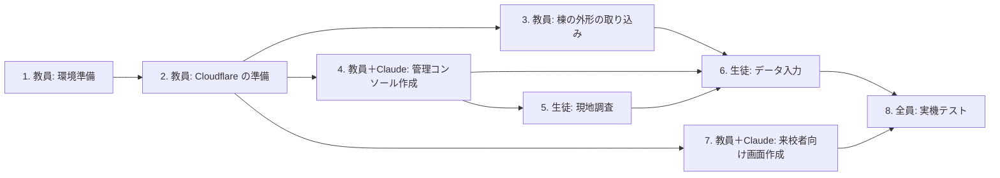

# 手順書 — 延岡工業高校 校内ARナビ（armap-v2）

| 項目 | 内容 |
|---|---|
| 版 | 0.2 |
| 作成日 | 2026-10-21 |
| 対応する文書 | [01_要件定義書.md](01_要件定義書.md) v0.3 / [02_設計書.md](02_設計書.md) v0.2 |
| 期間 | 2026-10-21（水）〜 2026-12 下旬 |

| 版 | 日付 | 内容 |
|---|---|---|
| 0.1 | 2026-10-21 | 初版ドラフト（生徒がPCでJSONを編集する前提） |
| 0.2 | 2026-10-21 | 生徒は Chromebook・スマートフォンの管理コンソールでデータを入力する方式に変更。公開先を Cloudflare に変更 |

この手順書は「誰が・いつ・何を・どうやって」行うかを定める。

- **教員の作業**は教師用PCで行う。コマンドは **VS Code のターミナル（PowerShell）** で実行する前提で書く。実行のたびに、Claude が手順を案内する
- **生徒の作業**は Chromebook とスマートフォンのブラウザだけで行う。ソフトのインストールは要らない

---

## 0. 全体の流れ



- 生徒がデータ入力を早く始められるよう、**管理コンソールを来校者向けの画面より先に作る**
- 一番遅れやすいのは **5. 現地調査**。第2週までに終わらせる。現地調査は管理コンソールが完成する前でも、紙の調査シート（付録A）で始められる

## 1. 教員: 環境準備（第1週）

教師用PCには Node.js v24.18・npm 11.16・git 2.54・Python（PyMuPDF）が入っていることを確認済み。

1. VS Code で `C:\programming\ARMAP` を開く
2. メニューの「ターミナル」→「新しいターミナル」を開く
3. 図面PDF（`29_R7延岡工業_図面.pdf`）がフォルダの直下にあることを確かめる。**PDFはgitに入らない**（`.gitignore` で除外済み）

プロジェクトの作成（Vite・React・ライブラリの導入）は、Claude が教師用PCで行い、実行したコマンドとその意味をその都度説明する。

## 2. 教員: Cloudflare の準備（第1週）

### 2.1 アカウント

- 旧ARmapで使った Cloudflare アカウントを使うか、新しく作るかを決める（要件定義書 Q-7）
- Cloudflare の無料プランのみを使う。支払い方法は登録しない

### 2.2 wrangler（Cloudflare を操作するコマンド）でログインする

```bash
npx wrangler login
```

ブラウザが開くので、Cloudflare にログインして「Allow」を押す。

### 2.3 データベース（D1）を作る

```bash
npx wrangler d1 create armap-v2
```

表示された `database_id` を `wrangler.toml` に書く（Claude が設定する）。

### 2.4 Pages のプロジェクトを作り、GitHub とつなぐ

1. Cloudflare ダッシュボード → **Workers & Pages** → **Create** → **Pages** → **Connect to Git**
2. GitHub の `junpei-dev/armap-v2` を選ぶ
3. プロジェクト名を `armap-v2` にする（空いていなければ別名にし、設計書 D-6 に記録する）
4. ビルドの設定:

| 項目 | 値 |
|---|---|
| Framework preset | なし（None） |
| Build command | `npm test && npm run build` |
| Build output directory | `dist` |

5. プロジェクトの **Settings** → **Bindings** で、D1 データベース `armap-v2` を変数名 `DB` で紐づける
6. これ以降、`main` に push すると自動で公開される。公開URLは `https://armap-v2.pages.dev/`

### 2.5 管理コンソールの認証（Cloudflare Access）

**第1週に最初に検証する**（設計書 D-7）。

1. Cloudflare ダッシュボード → **Zero Trust**（初回はチーム名を決める。無料プランを選ぶ）
2. **Access** → **Applications** → **Add an application** → **Self-hosted**
3. 保護するURLとして、次の2つを登録する
   - `armap-v2.pages.dev/admin`
   - `armap-v2.pages.dev/api/admin`
4. ログイン方法は **One-time PIN**（メールにコードが届く方式）
5. ポリシー（Policy）で「Allow」・「Emails」に、管理コンソールを使う人のメールアドレスを登録する
6. 確かめること
   - 登録したメールアドレスで `/admin` に入れる
   - 登録していないアドレスや、ログインしていない状態では入れない
   - 生徒の学校メールにワンタイムコードが届く（要件定義書 Q-6）

**生徒の追加・削除**: 5 のポリシーにメールアドレスを追加・削除する。年度末に見直す。

## 3. 教員: 棟の外形の取り込み（第1〜2週）

設計書4.3章のとおり、配置図は線データなので、棟の外形はスクリプトで取り出せる。この作業はPDFを使うため、教師用PCで行う。スクリプトは Claude が作る。

### 3.1 図面を画像に書き出す（作業用）

```bash
python tools/render_pages.py
```

`drawings/` に各ページの画像ができる（gitには入らない）。

### 3.2 棟の外形を抽出する

```bash
python tools/extract_outlines.py
```

| 出力 | 内容 |
|---|---|
| `drawings/outlines_preview.png` | 配置図の上に、抽出した長方形を番号つきで描いた画像 |
| `tools/outlines_draft.json` | 長方形ごとの全体座標（メートル）と寸法 |

### 3.3 番号と棟を対応づける

1. `outlines_preview.png` と配置図を見比べ、長方形の番号がどの棟か調べる（Claude が下書きを作り、教員が確かめる）
2. 寸法が平面図と合っているか確かめる（例: ㉘は 40.00×10.00m）
3. 次を実行すると、D1 に入れるためのSQLファイルができる

```bash
python tools/extract_outlines.py --apply
```

4. D1 に入れる

```bash
npx wrangler d1 execute armap-v2 --remote --file=drawings/buildings.sql
```

長方形でない棟（①管理・教室棟のL字部分など）の外形は、後で直す。

### 3.4 棟の向き（rotation）と基準点（origin）を決める

平面図の座標（u, v）を全体座標に変換するために、棟ごとに決める（設計書4.4章）。MVPで使う7棟（①・㉘・57・64・㊽・㉒・66）を先に行う。

1. 平面図の左上隅が、配置図ではどの隅にあたるかを調べる。手がかりは、階段の位置、渡り廊下がつながる位置、L字の形。平面図と配置図で上下が逆のことがある
2. その隅の全体座標を `origin`、回転を `rotation`（0 / 90 / 180 / 270）として登録する（Claude が図面を読んで下書きし、教員が確かめる）
3. 生徒がノードを入力した後、管理コンソールの地図で、階段や扉が棟の正しい側に表示されるかを確かめる

## 4. 教員＋Claude: 管理コンソール作成（第1〜3週）

設計書7.4章の管理コンソールを、生徒が使える順に作る。

| 週 | 作るもの | これで生徒ができること |
|---|---|---|
| 1〜2 | 認証・データの保存と検査・全体マップ・**現地調査メモ** | スマホで現地調査メモを残す |
| 2 | **地図エディタ**（ノード追加・辺・削除）・部屋の編集 | Chromebook でノードと部屋を入力する |
| 3 | 経路の確認・変更履歴と元に戻す・チェックポイントの編集 | 入力したデータで経路が出るか確かめる |

各段階ができたら、教員が自分の端末で試してから生徒に使ってもらう。

## 5. 生徒: 現地調査（第1〜2週）

**最優先の作業**。図面には出入口と屋外の通路が描かれていないため、ここが終わらないと各科職員室への経路が作れない。

### 5.1 準備するもの

- スマートフォン（管理コンソールの現地調査メモを使う。写真も撮る）
- 管理コンソールができる前は、紙の調査シート（付録A）と、対象の棟の平面図を印刷したもの（教員が `drawings/` から印刷する）
- メジャー（あれば。なくても歩数でよい。1歩 ≒ 0.7m）

### 5.2 調べること

| No. | 内容 | 現地調査メモの種類 |
|---|---|---|
| 1 | 各棟の**出入口**の位置と、ふだん開いているか | 出入口 |
| 2 | 管理棟から各棟までの**屋外の歩けるルート**（屋根のある通路を優先）の曲がり角 | 目印 |
| 3 | 曲がり角・分かれ道の**目印**（自販機・掲示板・植え込みなど） | 目印 |
| 4 | **階段**の位置（平面図の階段記号と合っているか） | その他 |
| 5 | 目的の部屋の**扉**の位置（部屋のどちら寄りか） | その他 |
| 6 | 通れない場所（施錠・立入禁止・工事中） | 通れない |
| 7 | 部屋の表示板の名前（図面の名前と違うか） | その他 |
| 8 | QRを貼れそうな壁（出入口・階段・渡り廊下の端） | QRを貼れる壁 |

### 5.3 現地調査メモの使い方（スマートフォン）

1. `https://armap-v2.pages.dev/admin` を開き、学校のメールアドレスを入れる → 届いたコードを入れる
2. 「現地調査メモ」を開き、棟と階（屋外なら「屋外」）を選ぶ
3. 今いる場所を地図でタップし、種類を選んでメモを書き、保存する
4. 写真はスマートフォンで撮り、メモに「写真あり（何枚目）」と書く（写真の添付機能は後日）

### 5.4 調査の順番

| 日 | 範囲 |
|---|---|
| 1日目 | 管理・教室棟①の1・2階（事務室・職員室・校長室・保健室・進路指導室・会議室） |
| 2日目 | 管理棟 → ㉘機械科・57電気電子科・64情報技術科 |
| 3日目 | 管理棟 → ㊽土木科・㉒環境化学システム科・66生活文化科 |
| 予備日 | 抜けの確認・写真の撮り直し |

写真は共有フォルダに置く。人が写っているものは使わない。

## 6. 生徒: データ入力（第2〜7週・Chromebook）

### 6.1 1棟ずつの作業手順

1. 管理コンソールの**地図エディタ**で、担当の棟と階を選ぶ
2. **ノードを置く**
   - 屋内: 廊下の中心線、扉の前、階段、出入口に置く。地図をタップして置いた後、平面図の寸法から計算した u・v を右の欄に入れて位置を合わせる（6.3）
   - 屋外: 現地調査メモ（▲）を見ながら、曲がり角に置く
   - 「目印」の欄に、来校者に伝わる説明を書く（例: 「自動販売機のある出入口」）
3. **辺でつなぐ**: 「辺」モードで2つのノードを順にタップする。階段は、上の階と下の階の階段ノード同士をつなぐ
4. **部屋を登録する**: 「部屋」の画面で、来校者向けの名前（例: 機械科 職員室）と図面上の名前（例: 準備室）を両方入れ、入口のノードを選ぶ
5. **確かめる**: 「経路の確認」で、事務室からその部屋までの道順と案内文を見る。不自然な案内文や遠回りがあれば直す
6. 画面下の「注意」の一覧が、自分の担当の棟について0件になるまで直す

**担当は棟ごとに分ける**（同じ棟を2人で同時に直すと、後から保存した方だけが残るため）。

### 6.2 進める順番

| 順 | 範囲 | 目的地 |
|---|---|---|
| 1 | ① 1階 | 職員室・校長室・保健室・進路指導室（事務室から同じ階） |
| 2 | ① 2階＋階段 | 会議室（階の移動の確認） |
| 3 | 屋外＋㉘ | 機械科 職員室（屋外経路の確認） |
| 4 | 57・64 | 電気電子科・情報技術科 職員室 |
| 5 | ㊽・㉒・66 | 土木科・環境化学システム科・生活文化科 職員室 |

### 6.3 ローカル座標の計算例（① 1階）

平面図: 幅 9.60m ＝ 部屋 7.10m ＋ 廊下 2.50m。北（図面の上）から 進路指導室 9.60／印刷室 4.50／保健室 9.00／便所 4.50／階段 4.00／事務室 9.00／校長室 9.00／職員室 18.00。

- 廊下の中心: u = 7.10 + 2.50 ÷ 2 = **8.35**
- 事務室の中央: v = 9.60 + 4.50 + 9.00 + 4.50 + 4.00 + 9.00 ÷ 2 = **36.1**

この「寸法を上から足していく」計算は、Google スプレッドシートで表にすると間違いが減る（Chromebook で使える）。

### 6.4 間違えたとき

- 「変更履歴」で自分の変更を探し、「元に戻す」を押す
- 消してしまったノードも、履歴から戻せる
- 分からなくなったら、触らずに教員に伝える（データは30日前まで戻せる）

## 7. 教員＋Claude: 来校者向け画面の作成（第3〜7週）

| 週 | 作るもの |
|---|---|
| 3 | 経路計算（ダイクストラ法・区間分割・曲がる方向・案内文）とテスト |
| 4 | ① スタート（目的地一覧）・② 全体マップ（ピン・道順の線） |
| 5 | ③ 案内（次へ・戻る・小さな地図）・⑥ 到着 |
| 6 | QR読み取り・④ カメラ表示（矢印）・⑦ 許可のお願い |
| 7 | 不具合修正・（余裕があれば）QRを基準にした矢印（マーカーAR） |

プログラムの変更は教師用PCで行い、`main` に push すると Cloudflare で自動的に公開される。公開の状況は Cloudflare ダッシュボードの Pages プロジェクトの **Deployments** で見られる。

## 8. 実機テスト（第5週〜・全員）

### 8.1 スマホで動かす方法

カメラとセンサーは HTTPS でないと動かない。公開URL `https://armap-v2.pages.dev/?cp=CP01` で行う。

- データの変更は保存した時点で反映される。画面を再読み込みすれば最新になる
- プログラムの変更は、push から公開まで2〜3分かかる

### 8.2 テストの段階

| 段階 | 時期 | 内容 |
|---|---|---|
| ① 管理コンソール上 | 第4週〜 | 「経路の確認」で全目的地の道順と案内文を見る（生徒・Chromebook） |
| ② 管理棟 | 第6週 | 実機で、事務室から管理棟の5室まで歩く。QRは画面に表示したものを仮に使う |
| ③ 屋外 | 第7週 | 各科職員室まで歩く。iPhone・Android の両方で |
| ④ 通し | 第8週 | **その棟を知らない生徒**が来校者役になり、説明なしで目的地に着けるか |

### 8.3 記録表

Google フォームか、付録Bの表を使う。

## 9. スケジュール

| 週 | 期間 | 教員＋Claude | 生徒 | 完了の目安 |
|---|---|---|---|---|
| 1 | 10/21〜10/27 | 環境準備・Cloudflare の準備・**Access の検証**・棟の外形の取り込み | 紙の調査シートで現地調査（管理棟） | 空のアプリと `/admin` のログインが公開URLで動く |
| 2 | 10/28〜11/3 | 管理コンソール（現地調査メモ・地図エディタ・部屋） | 現地調査（屋外・各科）を現地調査メモで | 生徒が Chromebook でノードを置ける |
| 3 | 11/4〜11/10 | 管理コンソール（経路の確認・履歴）・経路計算 | ① 1階のデータ入力 | 管理コンソールで事務室→職員室の経路が出る |
| 4 | 11/11〜11/17 | スタート・全体マップ | ① 2階・階段のデータ入力 | 来校者向けの全体マップに道順の線が出る |
| 5 | 11/18〜11/24 | 案内画面・到着 | 屋外＋㉘のデータ入力 | 管理棟5室を案内画面で最後まで進める |
| 6 | 11/25〜12/1 | QR読み取り・カメラ表示 | 57・64 のデータ入力・管理棟の実機テスト | **管理棟5室で実機で案内できる（MVPの最低ライン）** |
| 7 | 12/2〜12/8 | 不具合修正 | ㊽・㉒・66 のデータ入力・屋外の実機テスト | 各科職員室6室の経路ができる |
| 8 | 12/9〜12/15 | 不具合修正 | 通しテスト・発表資料 | 11室すべてで通しテストが終わる |
| 予備 | 12/16〜12月下旬 | 修正 | 発表準備 | — |

**遅れたときの判断**: 第6週の時点で管理棟5室が実機で動いていなければ、各科職員室は「㉘機械科のみ」に絞り、残りはMVP後に回す。

## 10. QRコードの作成と掲示（依頼があったとき）

**QRの作成・印刷は、教員から依頼があった時点で行う**（設計書10章）。それまでは次で代用する。

- 実機テストでは、管理コンソールのチェックポイント画面に表示したQRを、別の端末で映して読む
- 依頼があったら、印刷シートから印刷し、ラミネートして掲示する
- 掲示前に管理職の了承を得る（要件定義書 Q-2）

## 11. バックアップ（教員・月1回と発表前）

```bash
npx wrangler d1 export armap-v2 --remote --output=backup-armap-v2.sql
```

できたファイルは、日付を付けてリポジトリの外（共有フォルダなど）に保管する。

## 12. トラブルシューティング

| 症状 | 原因と対処 |
|---|---|
| 生徒が `/admin` に入れない | Access のポリシーにメールアドレスが登録されているか確かめる。コードのメールが迷惑メールに入っていないか確かめる |
| ワンタイムコードのメールが届かない | 学校のメールが外部からのメールを受け取れない設定の可能性がある（要件定義書 Q-6）。情報担当に確認する |
| 保存すると「保存できません」と出る | 致命的な誤り（存在しないノードを指している等）がある。メッセージに出たIDを確かめて直す |
| 部屋が来校者の一覧に出ない | 事務室からの経路がつながっていない。管理コンソールの「注意」と「経路の確認」で、つながっていない所を探す |
| スマホでカメラが映らない | `http://` で開いていないか確かめる（HTTPSが必要）。ブラウザの設定でカメラを許可する |
| iPhone で矢印が回らない | 動きセンサーの許可が必要。⑦の画面のボタンを押して「許可」を選ぶ。一度「拒否」した場合は Safari を閉じて開き直す |
| push したのに公開されない | Cloudflare の **Deployments** で失敗していないか確かめる。テストが失敗すると公開されない |
| `npx wrangler` が失敗する（教師用PC） | `npx wrangler login` をやり直す。プロキシのある回線では失敗することがある |

## 付録A 現地調査シート（紙・管理コンソールができる前に使う）

1棟につき1枚＋屋外ルート用に1枚。調査後、管理コンソールの現地調査メモに転記する。

```
┌──────────────────────────────────────┐
│ 現地調査シート      調査日:   /   担当:            │
│ 対象: 棟番号（  ） 名称（                   ） 階（  ）│
├──────────────────────────────────────┤
│ [ この欄に平面図の画像を貼る／手で描く ]                     │
│                                                            │
│   ○ 出入口   △ 階段   ■ 扉   □ QRを貼れる壁   × 通れない   │
├──────────────────────────────────────┤
│ No.│ 種類   │ 位置（どの端から約何m）│ 目印・メモ   │ 写真 │
│  1 │        │                       │              │      │
│  2 │        │                       │              │      │
│  3 │        │                       │              │      │
├──────────────────────────────────────┤
│ 図面と違う点（部屋名・壁・通路など）:                        │
│                                                            │
└──────────────────────────────────────┘
```

屋外ルート用:

```
┌──────────────────────────────────────┐
│ 屋外ルート調査   調査日:   /   担当:                       │
│ 管理棟の出入口（      ）→ 目的の棟（  ）の出入口（      ）  │
├──────────────────────────────────────┤
│ [ 配置図の該当部分を貼り、歩いた線を描く ]                   │
├──────────────────────────────────────┤
│ 角No.│ 曲がる方向 │ 前の角から（歩数/m）│ 目印        │ 写真 │
│   1  │            │                     │             │      │
│   2  │            │                     │             │      │
├──────────────────────────────────────┤
│ 屋根の有無 / 雨の日に通れるか / 段差:                       │
└──────────────────────────────────────┘
```

## 付録B 実機テストの記録表

| 日時 | 端末・ブラウザ | 出発→目的地 | 着けたか | 迷った地点 | 矢印のずれ（目視） | かかった時間 | 気づいたこと |
|---|---|---|---|---|---|---|---|
| | | | | | | | |
